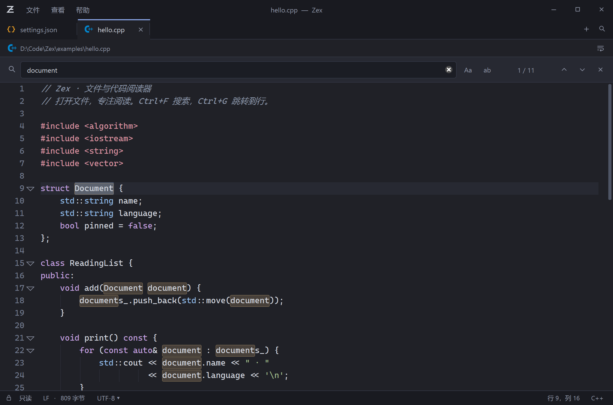

# Zex

一个专注于本地文件和代码阅读的 Windows 桌面工具。C++ + Qt 6 + Scintilla，提供接近 Zed 的简洁界面，不含项目管理。

**[下载 Windows x64 便携版](https://github.com/sclliang/Zex/releases/latest)** · [中文使用说明](USER_GUIDE.txt)

完整解压后运行 `Zex.exe`，保留旁边的 `bin` 文件夹。支持多标签、代码高亮、搜索、六套主题、字体与图标设置、会话恢复、单实例、Windows 文件关联和手动编码切换；所有操作保持只读。



A Windows file and code viewer, built with C++20, Qt 6 Widgets, Scintilla and Lexilla. Version 0.5.0.0. Company: sixunited. Author: sclliang.

This application is read-only. It opens local files directly, with draggable tabs, syntax highlighting, literal search (case and whole-word options), folding, line navigation and word wrap. There is no project or workspace model.

Version 0.5 adds a native single-instance launcher, per-user Windows integration, and per-file encoding selection. The launcher elects one owner per user/Windows session before loading Qt; subsequent launches forward bounded UTF-16 absolute paths using `WM_COPYDATA`. The receiver acknowledges a copied request and queues it on the UI thread. Batch requests preserve file order, focus existing tabs without duplicates, and load the final active file lazily. Empty launches activate the existing window. Concurrent starts and abandoned mutex ownership are handled without creating competing normal windows.

View → Windows Integration offers a legacy Explorer context-menu verb (under Show more options on Windows 11), a selectable list of text/code extensions, and removal of Zex's registrations. `OpenWithProgids`, application capabilities and the registered executable path are stored under HKCU; HKLM, extension defaults and `UserChoice` are not modified. Registry changes are journaled and rolled back on write failure. Removal preserves unrelated application entries. Choose **Save and set default opening method** to open Windows Default Apps, where the user can select Zex; moving the portable folder requires saving this registration again. Removing registration does not restore a default app previously chosen through Windows Settings: choose the replacement there. Registration follows Microsoft's [application registration](https://learn.microsoft.com/en-us/windows/win32/shell/app-registration) and [Default Apps settings](https://learn.microsoft.com/en-us/windows/apps/develop/launch/launch-default-apps-settings) APIs.

Click the status-bar encoding or File → Reopen with Encoding to choose Auto, UTF-8, GB18030, GBK, UTF-16 LE/BE or UTF-32 LE/BE. Manual Unicode selections also support BOM-less files; mismatched BOMs and invalid/truncated sequences produce retryable errors. Decoding runs off the UI thread, the latest selection wins during rapid changes, and no source bytes are written. Each tab's override and reading position survive session restoration, including dormant tabs; older sessions default to Auto.

Version 0.4 includes six built-in color themes: Graphite (the original dark default), Midnight Blue, North, Violet Night, Paper and Warm Sand. Choose a theme under View → Appearance (`Ctrl+,`). The dialog and sample editor preview the selection without changing the main window; Apply/OK updates the window, tabs, menus, search, syntax, line numbers and icons, then saves the preference. Cancel leaves the last applied choice intact. Startup selects the saved palette before constructing the window. Color changes reuse existing lexer styles and preserve selection, search results, folds and reading positions; dormant session tabs remain unloaded. Light themes use upstream light icon variants and suitable monochrome icon colors.

Version 0.3 automatically restores the open files, visual tab order, active tab and each document's reading position (top document line, wrapped-line offset, horizontal offset, caret and selection). Restored background tabs are lightweight placeholders: their editors, file reads, lexers and file watchers are created only on selection. No restored file is stat'ed or canonicalized on the UI thread. Startup command-line files are merged into the saved order without duplicates; the last explicit file takes focus.

Session metadata is saved locally to `%LOCALAPPDATA%/sixunited/Zex/session.json`, using atomic replacement and a one-second coalescing timer, with a final save on window close. It contains paths, positions and encoding choices, not document contents. Dormant, loading or temporarily unavailable files retain their saved positions. Missing files stay as retryable tabs; changed/shortened files clamp line and column values. Closing all tabs records an empty session. Corrupt/unknown-format session data is ignored; defensive limits are 4 MiB and 4096 restored tabs. The single-instance owner handles normal session writes within the current Windows login session.

Version 0.2 adds three offline file icon presets (Material, Seti Color and Seti Mono), filename/compound-extension matching, and a live appearance preview. Open View → Appearance (`Ctrl+,`) to set the editor family, size, bold/italic style, comment italics and line padding. Apply updates all open tabs without reloading files; preferences also apply to newly opened files and survive restart. The custom Windows chrome no longer extends a light system frame into the client area; Windows 11's outline is explicitly disabled, with square maximized corners.

## Build

Requires Visual Studio 2026 with the Desktop C++ workload, CMake 3.24+, Qt 6.8.3 MSVC x64 (qtbase, qt5compat and qtsvg). Build dependencies are not needed by the published application.

```powershell
# Optional local SDK bootstrap, in a Python environment with aqtinstall:
python -m aqt install-qt windows desktop 6.8.3 win64_msvc2022_64 --outputdir .tools/Qt --archives qtbase --modules qt5compat
python -m aqt install-qt windows desktop 6.8.3 win64_msvc2022_64 --outputdir .tools/Qt --archives qtsvg
powershell -ExecutionPolicy Bypass -File scripts/build.ps1
```

`build.ps1` configures, compiles Release, runs the integration tests and generates `package/`. It accepts `-QtRoot` for an existing Qt SDK. The source distributions of Scintilla 5.6.7 and Lexilla 5.5.4 are retained in `vendor/`, with their original licenses. `scripts/make-icon.ps1` regenerates the app's original geometric icon.

File icons and catalogs are checked in under `assets/file-icons` and embedded into the application DLL. They are loaded lazily and rendered icons are cached. No network access or icon-font installation is required at runtime. `scripts/vendor-icons.py` imports pinned upstream sources (requires Python `requests` and `fonttools`); provenance and MIT notices are in `vendor/icon-notices`. The Seti WOFF font is converted to TTF with unchanged glyphs. Standard VS Code language associations are resolved for standalone use; unknown types use each theme's generic file icon. Icon support does not imply a syntax lexer or binary-file reader for every format.

## Distribution

```
package/
  Zex.exe
  USER_GUIDE.txt
  bin/
    zex_app.dll
    Qt6*.dll
    MSVC runtime DLLs
    plugins/
    licenses/
```

The native launcher uses the absolute executable directory, `AddDllDirectory` and `LoadLibraryExW` to load the application DLL and runtime dependencies from `bin`. It has a static C++ runtime. Qt plugin search is explicitly set to `bin/plugins`. Application code is dynamically linked against Qt, and replacement-compatible Qt DLLs may be used under the Qt license terms. Qt remains unmodified.

The release must be extracted as a complete directory. A ZIP may be made from `package/`; this is a portable application, not an installer. Preferences and recent file paths are stored locally under `HKCU/Software/sixunited/Zex`. Files are never modified.

## Verification

`zex_tests` exercises encodings, binary rejection, read-only behavior, lexer output, Unicode byte offsets in search, case/whole-word options, wrapping search, duplicate tabs, background loading and closing during I/O. It also checks icon rendering/associations, font preferences, typography without loss of selection or search, dialog Apply/Cancel behavior, and supported DWM border/corner attributes. Session checks cover repeated restarts, moved/dormant/closed tabs, command-line priority, Unicode and wrapped reading positions, autosave, failed saves, corrupt metadata, missing files returning and file truncation.

For testing the final package from a clean PATH and arbitrary working directory:

```powershell
package/Zex.exe --verify-package C:/temp/zex-report.json --capture C:/temp/zex.png example.cpp
```

This diagnostic mode runs the real packaged application, reports when the file is ready and the window is exposed, optionally captures its own window, and exits. `startup_to_ready_ms` starts at entry to the native launcher and includes application DLL loading, but excludes Windows process creation before the entry point. `--find keyword` additionally exercises the search bar. Diagnostic mode does not persist settings.

`--verify-session C:/temp/isolated-session.json` enables reading/writing that explicit session file during diagnostics, without touching the user's normal session or preferences. `--verify-line 120` sets a reading position for restart verification. Reports include the ordered session and `loaded_tabs`, so a many-tab restore can be checked without accidentally benchmarking eager background loading. `scripts/verify-package.ps1` checks successive processes and compares one-file startup with 32 restored tabs from a clean PATH and a Chinese package path.

`--verify-theme paper` chooses an isolated diagnostic theme; `--capture-appearance C:/temp/appearance.png` also captures its settings dialog. The package checks capture all six themes, including light-theme search and code colors. Tests exercise theme switching without document reload, preview/Apply/Cancel behavior, persisted preferences and light/dark icon rendering.

`--verify-instance <unique-channel>` enables the real native launcher protocol on an isolated test channel; `scripts/verify-integration.ps1` tests batches, duplicate focus, activation, simultaneous launches, clean shutdown and crash recovery. `--verify-encoding utf-16le` tests a decoder override, including persistence between packaged processes. Registry tests operate under temporary HKCU test roots and preserve existing default/Open With entries. A test-only native probe verifies that `ShellExecuteEx` executes the registered command and passes an exact Unicode/spaced filename with `--`; it is not distributed. Integration-dialog screenshots use an isolated registration scope.

Limits: 256 MB per file; highlighting switches off above 8 MB or for lines longer than 20,000 characters. Literal search highlights up to 10,000 matches; next/previous continues through the full document. UTF-8 and BOM-marked UTF-16/32 are recognized, with GB18030/GBK fallback. No general-purpose encoding detector, save, replace, project management, language server, terminal, or plugin system is included.
