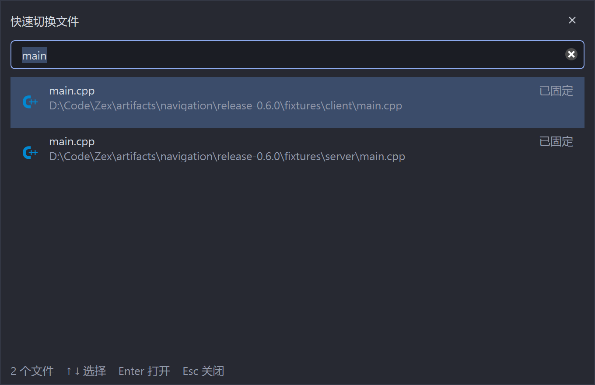

# Zex 0.6.0 导航、标签和日志跟随验证

验证环境：Windows 11 x64，Qt 6.8.3，Release，3840×2160 屏幕，系统缩放 200%。所有文件、会话和注册表检查使用隔离数据。正式程序属性为 Zex / sixunited / sclliang / 0.6.0.0 / English (United States)。

## 本次功能

- Ctrl+P 搜索已打开和最近 50 个文件。支持文件名/路径模糊匹配、空格分词、键盘选择、同名文件路径区分和六套主题。筛选不访问文件系统，不创建休眠标签的编辑器。
- 标签栏下拉列表可筛选全部标签。固定标签保留名称和图钉，在前方分组，组内可排序；普通关闭和批量关闭跳过固定标签。固定状态与顺序随会话保存，旧会话的缺省状态为未固定。
- “跟随文件”首次读取快照，后续后台增量读取。向上滚动暂停，回到底部继续；隐藏的标签停止轮询。文件轮换、缩短、清空、临时消失后恢复都经过验证。原文件始终保持只读。
- UTF-8 / GB18030 / GBK / UTF-16 LE/BE / UTF-32 LE/BE 的字符可以分多次写入。跟随器缓存未完成的字符，下一批补全后再显示。GB18030 补充平面字符同时验证普通打开和跟随两条路径。



## 回归检查

50 项 Qt 测试通过，涵盖七种编码逐字节追加、跨批次搜索边界、阅读位置与选区保留、暂停/继续、文件替换、删除恢复、清空后重新写入、超限停止、快速开启/停止、隐藏标签、加载中关闭，以及原有高亮、字体、主题、会话、Windows 集成与取消加载功能。

最终发布包检查：

| 检查组 | 场景数 | 内容 |
| --- | ---: | --- |
| 导航与跟随 | 17 | 六套主题、100 个标签与固定状态恢复、100–400% 有效缩放、UTF-16/GB18030 分次写入、大批量追加、轮换/清空/消失恢复、无效字符停止 |
| 性能与显示 | 21 | 原有六档缩放、大文件、长单行、两种加载取消阶段、超限文件、单文件和 100 标签启动 |
| 便携包 | 23 | 中文目录、不同工作目录、仅系统 PATH、主题、会话、搜索、手动编码和源文件校验 |

另有原生单实例及 Windows 集成验证。便携包中的 EXE、DLL、Qt 插件与运行库全部从包内或 Windows 系统目录加载；不要求安装 Qt 或 MSVC SDK。

## 实测

就绪时间从原生启动器入口计时，包含 DLL 加载，不包含 Windows 创建进程之前的耗时。使用已预热的文件缓存；三次启动的中位数用于比较，不能代表所有机器的冷启动速度。

| 场景 | 0.5.2 | 0.6.0 |
| --- | ---: | ---: |
| 小文件，三次中位数 | 406 ms | 406 ms |
| 恢复 100 个标签，三次中位数 | 500 ms | 484 ms |
| 1 MiB ASCII 单行 | 406 ms | 422 ms |
| 100 MiB 日志 | 984 ms | 1000 ms |
| 240 MiB 日志 | 1766 ms | 1797 ms |

100 标签检查始终只载入当前文件，新增导航与固定功能没有增加后台文件读取。数十毫秒差异接近诊断轮询粒度及运行波动，不据此宣称细微性能提升或退步。240 MiB 文件加载期间观测到的最大界面心跳间隔为 17 ms。

跟随测试中，在约 1 MiB 日志上分批追加中文和表情，最终文档为 4,500,000 字节；完整文档 SHA-256 与预期一致，最大界面心跳间隔为 18 ms。UTF-16、GB18030、轮换与无效输入场景的最大间隔为 16–20 ms。原文件在外部测试脚本完成写入之后的散列保持不变。

## 使用边界

- 跟随适用于追加日志和常见轮换方式。每次轮询比较文件身份、长度、写入时间及首尾各 4 KiB 样本，不全量比较旧内容；同时增长且保留采样边界的任意中间改写不保证被发现。
- 暂停可能让已开始的一小批追加完成，但不会主动拉回底部。被替换的文件不会在暂停阅读时覆盖旧内容。
- 跟随模式不跨重启保存；重新载入或切换编码会停止跟随。字符不完整时等待后续字节；无效编码或超过 256 MiB 则停止并保留已有内容。
- 文件读取与解码在后台执行。取消会立即使旧任务失效，但不能打断已经进入的阻塞系统调用。
- 中文与表情混合的极长单行仍有首次排版停顿。本轮约 704 KiB 混合单行的首次加载最大界面间隔为 499 ms；普通日志追加不等同于这种极端单行场景。
- 缩放验证为同一物理屏幕上的进程级缩放覆盖。未实测 Windows 10，也未进行真实多显示器热插拔验证。

## 重现

```powershell
powershell -NoProfile -ExecutionPolicy Bypass -File scripts/build.ps1
python scripts/verify-navigation.py --label release-0.6.0
python scripts/verify-performance.py --label release-0.6.0 --enforce
powershell -NoProfile -ExecutionPolicy Bypass -File scripts/verify-package.ps1
```

原始报告、截图与临时文件位于忽略提交的 `artifacts/navigation/release-0.6.0/`、`artifacts/performance/release-0.6.0/` 和 `artifacts/`；测试不写入日常会话或偏好。
