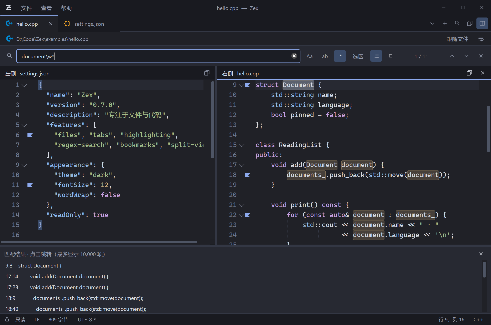

# Zex 0.7.0 搜索、书签和分屏验证

验证环境：Windows 11 x64，Qt 6.8.3，Release，3840×2160 屏幕，系统缩放 200%。正式程序属性为 Zex / sixunited / sclliang / 0.7.0.0 / English (United States)。所有检查使用隔离文件、会话和注册表数据。



## 本次功能

- 搜索栏增加 Unicode 正则、固定选区、结果列表和取消。点击结果按行列跳转，列表按需生成可见行的预览，最多列出并高亮 10,000 项；F3 / Shift+F3 可以继续查找列表以外的匹配。正则使用静态链接的 PCRE2 10.49，工作线程只读取不可变 UTF-8 快照，窗口不在后台线程操作。
- 正则快照按 512 KiB 分批复制；查询更换、取消、文件关闭或内容变化会使旧结果失效。默认约三秒截止，同时设置匹配、深度、堆、编译体积与嵌套限制。复杂表达式显示错误，原文仍可阅读。修正了未选中文本时从光标开始的查找，以及文件末尾零长度匹配的循环导航。
- Ctrl+F2 或书签栏切换行书签，F2 / Shift+F2 循环跳转，最多每个文件 1,000 个。书签在主题/字体变化和重新载入后保留，超出文件长度的行会移除，同一文件的两侧视图同步。
- Ctrl+\ 左右分屏，每侧独立保存阅读位置和编码。点击一侧后，标签、打开文件、搜索、跳转和日志跟随作用于该侧。关闭右侧分屏保留左侧及标签；关闭右侧文件的标签会收起分屏。固定标签继续受关闭保护。
- 会话 version 1 增加可选书签与分屏字段，兼容旧会话。恢复只加载当前一侧或两侧可见内容，其他标签不创建编辑器、不读取文件。书签和分屏操作不写入源文件。

## 回归检查

58 项 Qt 测试通过，覆盖中文/CRLF/零长度正则、无效表达式、复杂度限制、取消及结果竞态、固定选区、10,000 项以外的导航、真实搜索控件与结果点击、书签跳转和文件缩短、同一文件双视图独立位置、书签同步、分屏关闭与固定标签、100 标签懒恢复、重复重启、命令行优先级，以及原有字体、主题、编码、只读、加载取消、日志跟随与 Windows 集成。

| 发布包检查组 | 场景数 | 内容 |
| --- | ---: | --- |
| 搜索、书签和分屏 | 20 | 两侧恢复、书签跨进程保存、100 标签只加载两侧、六主题、100–400% 缩放、选区、无效/复杂表达式、约 67 MiB 文档取消与源文件散列 |
| 导航与日志跟随 | 17 | 六主题、固定标签、100–400% 切换器缩放、Unicode/GB18030 分次追加、文件轮换、截断、消失恢复、无效输入与散列 |
| 性能与显示 | 21 | 六档缩放、10/100/240 MiB 文件、长单行、解码/准备文档时取消、超限、小文件与 100 标签启动 |
| 通用便携包 | 23 | 中文路径、不同工作目录、仅系统 PATH、主题、会话、手动编码、搜索与源文件只读 |

另有原生单实例的批量转交、并发启动、正常关闭和崩溃恢复检查。包内附有 PCRE2 及其他第三方组件许可；Qt 和 MSVC 运行库从 `bin` 加载，主程序在包根目录。

## 启动与响应

计时从原生启动器入口到窗口暴露且可见文档载入完成，包含 DLL 加载，不含 Windows 创建进程之前的耗时。诊断轮询间隔为 30 ms。数据为本机缓存条件下的观测值，不代表所有机器的冷启动。

首轮性能检查的 100 标签启动存在 562–968 ms 波动。因此追加了同机、相同文件与会话、两版交替启动的五轮对比，且每轮均只加载一个编辑器：

| 场景 | 0.6.0 五轮中位数 | 0.7.0 五轮中位数 |
| --- | ---: | ---: |
| 小文件 | 406 ms | 438 ms |
| 100 个标签，只加载活动文件 | 516 ms | 516 ms |

32 ms 的小文件差异接近一次诊断轮询；不据此宣称细微性能提升或回退。最终发布包分屏恢复检查中，100 标签、同一小文件的两个独立视图约 532–609 ms 就绪；这组文件与上表不同，不能直接计算分屏开销。

本轮 100 MiB / 240 MiB 日志分别约 1,032 / 2,109 ms 就绪，加载阶段最大观测界面心跳间隔为 21 / 25 ms；加载后的普通文字搜索最大间隔均为 26 ms。最终 20 项搜索/分屏检查的最大就绪后心跳间隔为 19 ms，复杂表达式被限制时为 16 ms，取消正则场景为 17 ms。心跳目标间隔为 16 ms，不等同于逐帧性能保证。

## 使用边界

- 选区正则将选中文本作为独立搜索内容，锚点与前后文不跨越选区。输入框最多 4,096 个字符，禁止拆开 UTF-8 字符的 `\C`。超时/复杂度限制可能使一次全文件搜索不能完成；可以缩小选区或简化表达式。取消后保留已得到的结果，Enter 重试。
- 正则匹配的是快照，日志追加后会提示按 Enter 重新搜索。普通文字搜索保留增量更新。
- 书签按行号保存，不追踪外部编辑前的原文；关闭标签会移除其会话记录。两侧独立读取文件、编码与滚动，不提供差异比较、同步滚动或项目管理。
- 每个文件原始大小上限仍为 256 MiB，8 MiB 以上或单行超过 20,000 字符时关闭语法高亮。大量中文/表情组成的极长单行仍可能发生首次排版停顿，本轮约 704 KiB 单行最大加载心跳间隔为 454 ms。
- 跟随仍适用于追加日志与常见轮换；不会全量比对任意中间改写，不跨重启自动开启。取消不能中断已经进入的阻塞文件系统调用。
- 缩放是同一物理屏幕上的进程级覆盖；未实测 Windows 10 或真实多显示器热插拔。

## 重现

```powershell
powershell -NoProfile -ExecutionPolicy Bypass -File scripts/build.ps1
python scripts/verify-reading.py --label final-0.7.0
python scripts/verify-navigation.py --label release-0.7.0
python scripts/verify-performance.py --label release-0.7.0 --enforce
powershell -NoProfile -ExecutionPolicy Bypass -File scripts/verify-package.ps1
```

报告位于忽略提交的 `artifacts/reading/final-0.7.0/`、`artifacts/navigation/release-0.7.0/`、`artifacts/performance/release-0.7.0/` 和 `artifacts/package-verification.json`。交替启动的逐次结果保存在 `artifacts/startup-comparison-0.7/summary.json`。测试不写入日常会话和偏好。
