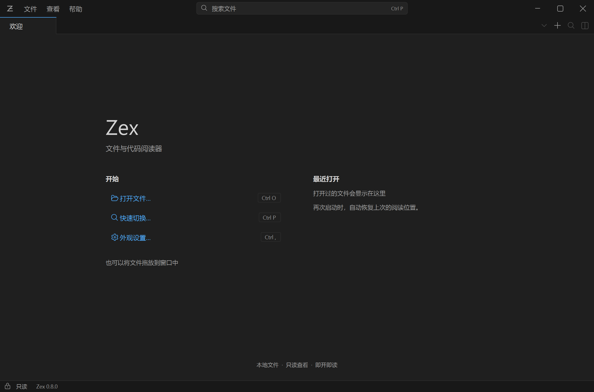
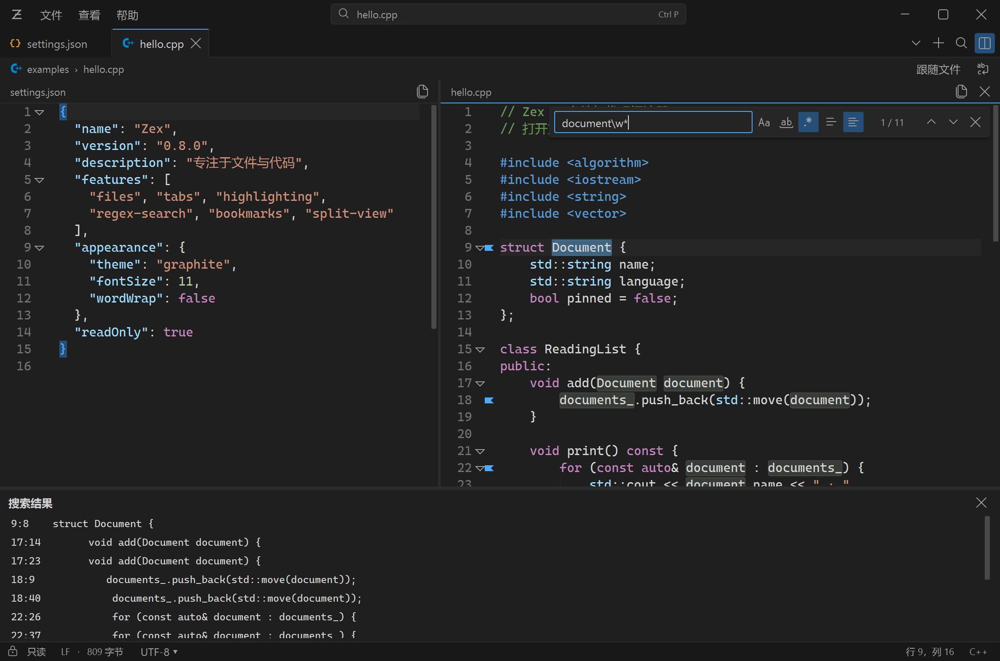
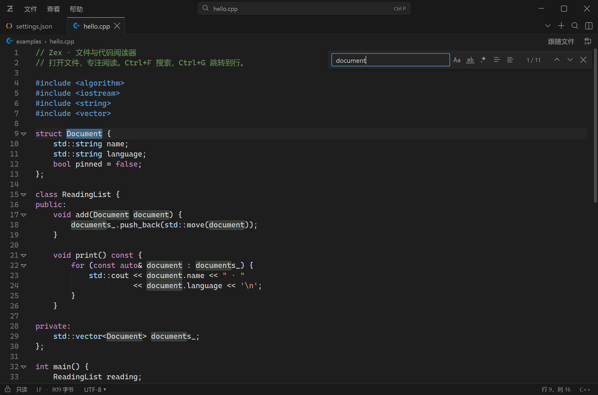

# Zex 0.8.0 界面调整与发布验证

验证环境：Windows 11 x64、Qt 6.8.3、MSVC Release，3840×2160 屏幕，系统缩放 200%。版本资源为 Zex / sixunited / sclliang / 0.8.0.0 / English (United States)。测试使用隔离会话和临时文件，不修改日常偏好或源文件。


## 界面变化

- 石墨主题改为中性深灰，降低分隔线的对比度，统一蓝色强调色。标题栏和标签均为 34 个逻辑像素，路径栏 26，状态栏 23；其他五套主题使用同一套控件尺寸。
- 标题栏中间可点击打开 Ctrl+P 文件切换器。标签、路径、分屏标题和文件切换器收紧留白，完整路径保留在提示中。欢迎页用两列组织操作入口与最近文件，空会话隐藏文件路径栏。
- 工具栏采用 24 个 Microsoft Codicons SVG，按显示缩放绘制并缓存。图标原始路径未修改，绘制时应用主题色；CC BY 4.0 授权、作者归属、来源及散列随包分发。Material / Seti 文件图标预设继续保留。
- 搜索栏悬浮在当前阅读区右上方，窄分屏自动使用两行。单独显示或关闭搜索栏不会改变编辑器尺寸或阅读位置；打开结果列表仍会分配独立面板空间。错误和结果摘要的完整内容可通过提示查看。
- 默认正文优先 Cascadia Mono，其次 Consolas，再次 Cascadia Code；字号 11 pt、额外行间留白 3、注释正体。只迁移与旧出厂配置完全一致且尚无迁移标记的偏好，已有自定义设置保持。外观设置仍可调整全部字体选项。





## 回归验证

61 项 Qt 检查通过，包含新增的默认字体迁移/自定义保留、100%–400% 矢量图标尺寸与禁用态、搜索浮层不改变阅读位置、最窄分屏/切换活动侧/窗口缩放后的控件边界检查，以及原有搜索、书签、会话、只读、编码、加载取消和 Windows 集成测试。

20 项搜索/书签/分屏与 17 项导航/日志检查通过。覆盖六套主题、100%–400% 缩放、选区正则、复杂表达式与取消、100 标签惰性恢复、固定标签、文件切换器、分次追加、轮换与编码边界。搜索浮层的边界检查包含所有可见的嵌套控件。

21 项性能/显示检查通过，覆盖六档缩放、外观与集成窗口、10/100/240 MiB 文件、超长行、加载取消与大小限制。100 MiB / 240 MiB 日志分别约 1,000 / 1,812 ms 就绪，加载阶段最大观测心跳间隔为 22 / 18 ms，加载后搜索最大间隔均为 27 ms。

23 项通用便携包检查及原生单实例检查通过：发布目录复制到中文路径，从不同工作目录和仅系统 PATH 启动，验证主题、字体窗口、搜索、会话、手动编码、批量转交、并发启动与崩溃恢复。EXE 公司、作者版权、名称、四段版本、原始文件名和 English (United States) 资源语言均已核对。根目录为 `Zex.exe` 和说明文件，运行库、插件与许可放在 `bin/`。

## 启动对比

两版使用相同的小文件、相同会话、仅系统 PATH 和不同工作目录，五轮交替启动。每次 100 标签恢复均只载入一个编辑器。

| 场景 | 0.7.0 中位数 | 0.8.0 中位数 |
| --- | ---: | ---: |
| 小文件 | 375 ms | 390 ms |
| 100 标签，仅载入活动文件 | 469 ms | 500 ms |

计时从原生启动器入口到窗口暴露且文件就绪，包含 DLL 加载，不包含 Windows 创建进程之前的耗时，诊断轮询间隔约 30 ms。数据是同机缓存条件下的观测值；15–31 ms 的差异不用于宣称细微性能提升或回退，也不代表其他设备的冷启动。分屏恢复检查中，100 标签、两个可见视图约 531 ms 就绪。



## 重现

```powershell
powershell -NoProfile -ExecutionPolicy Bypass -File scripts/build.ps1
python scripts/verify-reading.py --label release-0.8.0
python scripts/verify-navigation.py --label release-0.8.0
python scripts/verify-performance.py --label release-0.8.0 --enforce
powershell -NoProfile -ExecutionPolicy Bypass -File scripts/verify-package.ps1
```

逐项结果及截图保存在忽略提交的 `artifacts/reading/release-0.8.0`、`artifacts/navigation/release-0.8.0`、`artifacts/performance/release-0.8.0`，启动对比保存在 `artifacts/startup-comparison-0.8/summary.json`。

所有缩放检查均为同一屏幕上的进程级覆盖，没有更改系统显示设置。未实测 Windows 10 或真实多显示器热插拔。单文件仍限制为 256 MiB，超过 8 MiB 或单行超过 20,000 字符关闭高亮；大量中文/表情组成的极长单行仍需正常字体排版。搜索与日志跟随的原有限制见 [0.7.0 验证](validation-0.7.0.md)。
